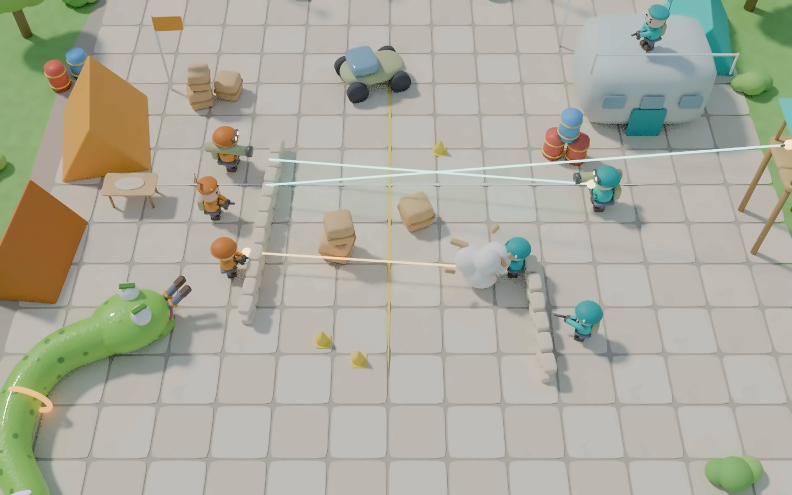
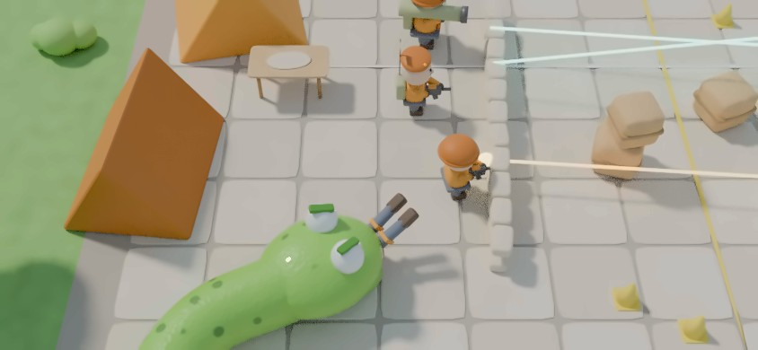
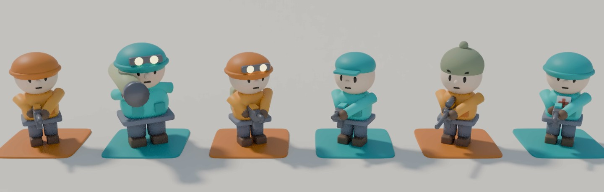

<!-- Version 0.11 was a text export of https://claude.ai/artifact/JaHE6W4wZXCXgp5L4jdTPP (exported 2026-09-21). Version 0.12 was written in the repository on 2026-10-13 and the artifact does not hold it: the artifact is behind until somebody carries this change back into it. -->

# Chomp Company
*Рабочее название. Змейка-хищник в шутерной арене.*

**Концепт-документ, версия 0.12**
*Правка 0.12 от 2026-10-13: сокровище, эвакуация и конец матча (раздел 6.4). Ею закрыты четыре открытых вопроса раздела 14. Нумерация разделов не менялась — на неё ссылаются требования и код.*
Платформы: iOS 27+ / macOS 27+ (Apple silicon), основная цель — iPhone
Статус: пре-продакшн. Технический спайк **не проведён** — все решения ниже приняты в допущении, что он пройдёт.

**Спайк, который должен это допущение подтвердить.** Два-три дня, три проверки, каждая может закрыть выбранный стек:

1. Змея-сплайн через `LowLevelMesh`, ползущая по навмешу с вертикальным перепадом (лестница или прыжок с балкона). Если хвост здесь выглядит и ощущается правильно — половина риска снята.

2. Восемь сущностей на навмеше с utility-выбором действия: замер кадрового времени на реальном iPhone, не на симуляторе. Мерить худший случай — все восемь на каждом кадре, как верхнюю границу нагрузки; штатная схема с планированием по времени описана в разделе 9.2 и должна укладываться с запасом.

3. Один вызов Foundation Models параллельно с рендером: проседает ли кадр в момент инференса и как быстро греется устройство.

Все три зелёные — RealityKit остаётся. Спотыкается первая или третья — переезд на SwiftGodot (раздел 10), потеряв три дня, а не полгода.

## 1. Суть

Классическая змейка, перенесённая в трёхмерную многоуровневую арену военного шутера. Игрок управляет змеёй, которая ползёт по геометрии карты и охотится на **два враждующих отряда ботов**. Боты не декорация: они ведут между собой полноценный бой, видят змею, реагируют на неё, отступают, координируются и наносят урон.

**Ключевая асимметрия.** Змея медленная, растущая, без огнестрельного оружия. Боты быстрые, вооружённые и организованные. Чем больше змея съела, тем она сильнее — и тем труднее ей маневрировать в узких коридорах.

**Ядро цикла.** Живая добыча даёт существенно больше очков, чем добитая или случайно погибшая. Это заставляет игрока лезть в опасные ситуации вместо того, чтобы отсиживаться и подбирать трупы.

**Стратегический слой: война должна продолжаться.** Пока отряды заняты друг другом, змея может ждать, выбирать момент и подбирать тех, кто остался без прикрытия. Но если одна сторона вырежет другую, выжившие больше не воюют: они забирают сокровище и уходят к точке эвакуации, и змея остаётся один на один с организованной группой, которую больше нечем отвлечь, да ещё и с часами. Игроку выгодно не просто есть, а **поддерживать баланс сил**: не выедать слабую сторону до конца, вовремя прореживать сильную. Жадность наказывается автоматически, без искусственных ограничений — и наказывается буквально, потому что отряд считается уничтоженным и тогда, когда последнего его бойца съела змея (раздел 6.4).

**Два акта.** Первый — война отрядов, в которой змея выбирает момент. Второй начинается, когда один отряд решил, что второго больше нет: сокровище становится можно поднять, победители несут его к выходу, и единственное, что стоит между ними и концом матча, — змея. Второй акт короткий, и он есть у всякого матча, в котором кто-то из ботов дожил до конца войны: съевшая всех змея обходится без него.

**Что продаёт игру.** Не тактика ботов сама по себе, а их *голоса*: паникующие переговоры, callout'ы, взаимные обвинения, реакция на абсурд происходящего. Отряд, который осознаёт, что на них охотится змея — это то, чего нет больше нигде.

---

## 2. Визуальный стиль

**Уютная диорама с физической комедией.** Референсы: Overcooked (обе части), Moving Out, Two Point Museum. Не военный реализм и не стилизованные шутеры — ранние референсы (Overwatch, TF2, Diablo 2) отброшены как неточные.

**Что берётся из референсов:**

- **Мир как диорама.** Плотно заставленное пространство, где каждый угол набит предметами, с которыми что-то может произойти.

- **Пухлые округлые формы.** Ничего острого и угловатого; предметы и архитектура выглядят мягкими, почти игрушечными.

- **Персонажи с крупной головой** и короткими конечностями, простым силуэтом и цветом, который считывается даже на крошечном размере.

- **Яркий дневной свет**, мягкие тени, насыщенная палитра. Никакого сумрака.

- **Комедия через физику и хаос:** разлетающиеся укрытия, кувыркающиеся бойцы, паника — смешно, а не драматично.

**Масштаб создаётся плотностью, а не размером.** Территория больше, чем уровни Overcooked, — ближе к Two Point, — но ощущение богатого мира даёт насыщенность деталями, а не площадь пустого пола.

**Правовая сторона не меняется:** стиль не охраняется, копировать нельзя конкретных персонажей, интерфейсы и узнаваемые элементы референсов.

Решение в пользу стилизации принято не по вкусовым соображениям — оно выигрывает по трём независимым линиям сразу.

**Тон.** Гигантская змея, поедающая солдат, в реализме читается как body horror и утаскивает игру в мрачность. В стилизации это комедия — и тогда паникующие реплики ботов превращаются из странности в сердцевину игры. Отряд, орущий «ОНО СЪЕЛО ДЭВИСА», работает только здесь.

**Производство.** Реализм оценивается по шкале «насколько похоже на настоящее», где соло-проект проигрывает всегда. Стилизация судится по внутренней согласованности, а её можно выдержать в одиночку. Плюс читаемость под камерой сверху и на экране телефона: чистые силуэты, цвет несёт информацию.

**Юридическая чистота.** Реалистичная военная карта неизбежно тянет ассоциации с конкретным шутером. Стилизованная — не с чем сравнивать, вопрос об узнаваемости просто не возникает. Сам стиль при этом не охраняется.

**Ограничение:** стилизация не должна съесть тактическую честность. Укрытие обязано выглядеть укрытием, сайтлайн — читаться сразу, высота — считываться с камеры сверху. Форма условная, пространство точное.

**Читаемость сторон — отдельное требование.** Принадлежность бота к отряду должна считываться мгновенно и с любого ракурса: цвет корпуса, силуэт снаряжения, цвет трассеров. Игрок принимает решения «кого съесть» на основе баланса сил, и если он путает стороны, весь стратегический слой не работает. Плюс третья категория — раненые и отбившиеся, которые тоже должны выделяться.

**Что стиль открывает механически:**

- Читаемые состояния — персонаж буквально *выглядит* паникующим (поза, тряска, эффект над головой). Веса личности от командира получают визуальное выражение, и игрок видит, кто сейчас сломается.

- Поедание перестаёт быть проблемой: подбросить, проглотить целиком, выпуклость по телу, ботинки торчат. Смешно и без расчленёнки.

- Деформация змеи: сплющивание в узком проходе, растягивание, раздувание по мере насыщения. Принципы squash & stretch — профильная тема для змеи.

- Преувеличенная физика и комичные смерти: то, что в реализме выглядит багом, здесь выглядит фичей.

**Интерфейс в той же эстетике:** округлые светлые плашки, жирный округлый шрифт, крупные читаемые иконки. Не милитаристский HUD со скошенными плашками — он спорит со стилем мира.

### 2.1 Как производится визуал

Визуал собирается **скриптом как 3D-сцена**, а не рисуется. Пробные рендеры концепта сделаны именно так: сцена процедурно собирается в Blender через Python и рендерится камерой под углом. Рисование кодом в SVG проверено и отвергнуто — оно упирается в потолок «детского рисунка» независимо от старания.

Для выбранного стиля это удачное совпадение: он строится из скруглённых примитивов, и процедурная сборка даёт результат, близкий к финальному, без художника и ассет-паков. В самой игре то же самое живёт в RealityKit как реальное 3D; Blender-скрипты (`materials/render/`) остаются инструментом для концепт-рендеров и, возможно, для генерации моделей в USDZ.

**Ограничение:** персонажи из примитивов хорошо работают на расстоянии игровой камеры, но на крупных планах (меню, портреты, трейлер) их может не хватить. Там, вероятно, понадобятся отдельно смоделированные модели.

### 2.2 Концепт-арт

Пробные рендеры, собранные скриптом из `materials/render/`. Они фиксируют направление — камеру, свет, пропорции, плотность мира и эстетику интерфейса, — а не финальную графику. Интерактивные версии с переключаемым интерфейсом — [на холсте](https://claude.ai/artifact/7TmR7eBewc8kwmAdqBLr8N).

*Общий план.* Оранжевый лагерь слева, бирюзовый бункер и вышка справа, посередине ящик разлетается под огнём. Змея подползает к оранжевым сзади и глотает бойца — никто не оборачивается. Слабое место кадра: нижняя треть пустовата, что противоречит принципу плотности; следующая итерация должна её заполнить.

*Крупный план.* Оранжевые стоят спиной к змее, из пасти торчат ботинки. Это кадр для механики свидетельства (раздел 6.1): никто не видел — поедание идеальное.

*Архетипы* (раздел 8): штурмовик, тяжёлый, сапёр, разведчик, снайпер, медик. Крупная голова, короткие конечности, силуэт различим по головному убору и оружию, сторона — по цвету.

---

## 3. Вид и управление

- Основная камера — **перспективная, под углом 50–60° сверху**, как в референсах; не строгая изометрия. Камера фиксированного угла, следует за змеёй.

- Вид от первого лица (из головы змеи) в эту эстетику ложится плохо; оставлен как необязательная идея, в вертикальный срез не входит.

- Многоуровневые карты: этажи, лестницы, балконы, перепады высот.

- Абстракция ввода закладывается с первого дня: на macOS клавиатура и мышь, на iOS тач (свайпы, удержание направления). Схемы проектируются раздельно, а не адаптируются одна из другой.

---

## 4. Механика змеи

Змея живёт на графе поверхностей (навмеше), а не летает в пространстве. Она именно **ползёт по геометрии**.

- Голова движется по навмешу, включая вертикальные переходы — лестницы, спуски, прыжки с уступов.

- Хвост — сплайн, точно повторяющий пройденный путь головы, со всеми вертикальными участками.

- Меш хвоста генерируется процедурно каждый кадр.

**Производные механики, которые это даёт бесплатно:**

- Тело змеи перегораживает проходы и лестницы. Длинная змея может отрезать отряду путь отступления — или запереть саму себя.

- Узкие коридоры становятся риском по мере роста, а не только преимуществом.

- Вертикальность работает в обе стороны: боты уходят на этажи, куда змее долго подниматься; змея срезает через провалы, куда боты не спрыгнут.

---

## 5. Способности от поедания

Съеденный бот передаёт змее способность своего архетипа. Сила приходит из акта поедания, а не из лута с земли.

**Что это даёт:**

- Появляется причина выбирать *кого* есть, а не есть ближайшего.

- Архетипы ботов становятся геймплейно значимыми, а не только визуальными.

- Петля «чем опаснее добыча, тем ценнее награда».

**Жёсткое ограничение: способности не стреляют.**

Как только змея получает огневую мощь, вся асимметрия концепта рушится — и рушится в скучную сторону: вместо подкрадывания и засад игрок едет по центру карты и косит. Способности меняют движение и пространство, но не превращают змею в огневую платформу. Единственное исключение — разрушение укрытий от сапёра и тяжёлого, поскольку оно работает по геометрии, а не по людям.

| Съеден | Способность | Что меняет |
|---|---|---|
| Штурмовик | Рывок | Догнать убегающего, разорвать дистанцию |
| Сапёр | Проламывание перегородок | Новые маршруты в обход коридоров |
| Разведчик | Видеть ботов сквозь стены | Планирование засады |
| Снайпер | Подсветка, замедление времени | Точный бросок на дистанции |
| Медик | Восстановление здоровья | Выживаемость после плохой стычки |
| Тяжёлый | Временная броня, разрушение | Пережить сфокусированный огонь; сносить укрытия быстрее |

**Заряды висят на сегментах тела.** Одноразовые, привязаны к конкретному сегменту. Отсюда вторая петля: длинная змея несёт много способностей, но неповоротлива и легко простреливается; короткая юркая, но пустая.

**Урон отстреливает хвост с конца** — вместе с накопленными способностями. Потеря длины перестаёт быть абстрактным штрафом и становится потерей конкретных возможностей. Заодно объясняет, зачем боты вообще стреляют по хвосту, и делает это осмысленным тактическим действием.

---

## 6. Счёт, свидетели и тела

Счёт устроен так, чтобы поощрять замысел игры, а не перечень красивых трюков. Конкретные условия вида «съел с высоты» или «съел двоих подряд» отвергнуты: игрок находит два-три самых прибыльных и начинает их фармить, и система, задуманная как поощрение разнообразия, превращается в чеклист.

Вместо этого — три независимые оси, которые перемножаются. Красивые ситуации возникают на их пересечении сами: съесть командира лидирующего отряда так, чтобы никто не заметил, действительно требует и подготовки, и риска.

| Ось | Условие | Что поощряет |
|---|---|---|
| Скрытность | Никто не видел поедания | Засаду вместо погони |
| Баланс сил | Съеден боец лидирующего отряда | Поддержание войны |
| Ценность цели | Командир, тяжёлый, медик | Тактический выбор, а не ближайшее |

**Очки даёт поедание, а не смерть.** Боец, убитый чужим отрядом, сам по себе не приносит змее ничего. Съеденное тело приносит, но по пониженной базовой ставке: живая добыча сопротивляется, занимает больше времени и потому стоит дороже. Множители при этом работают одинаково — труп, съеденный незаметно, остаётся скрытым поеданием со всеми вытекающими (раздел 6.2). Ось баланса сил делает чужую войну выгодной косвенно: она создаёт отвлечение, раненых и тела. Смотреть полезно, бездействовать нет.

### 6.1 Свидетельство

Скрытность определяется не тем, знала ли жертва, а тем, **кто видел момент поедания**. Это превращает стелс из мгновенной проверки в состояние, которое надо поддерживать: игрок обязан читать позиции всего отряда, а не только цели.

| Уровень | Условие | Как это выглядит |
|---|---|---|
| Открытое | Видели свои | Обычная охота |
| Скрытое | Свои не видели | Человек просто пропал |
| Идеальное | Ни один отряд не видел | Змеи как будто не существует |

Технически — линия видимости от каждого живого бота к точке события. Две поправки к наивной проверке:

- **Окно в 2–3 секунды**, чтобы утаскивание в тень тоже считалось; иначе выгодно есть строго мгновенно.

- **Свидетелем считается и тот, кто увидел место сразу после** — добежавший через секунду фактически всё понял.

**Свидетельство — это знание, а не флаг.** Увидевший докладывает командиру, и тот меняет приоритет угрозы. Отсюда осмысленная задача: убить единственного видевшего до того, как он доложит. Это единственный случай, где змее выгодно есть быстро и грязно.

### 6.2 Тела

**Змея поглощает тела, отряды — нет.** Отсюда отряд узнаёт о змее не из того, что кто-то её видел, а из того, что **пропадают тела**. Убили своего — труп лежит, это привычно. Пропал бесследно — объяснения нет, и это пугает сильнее прямого столкновения. Никакого искусственного «командир начинает подозревать» не требуется: подозрение растёт из наблюдаемого факта.

У игрока появляется выбор с реальной ценой:

- **Съесть** — очки и способность, но исчезновение, которое рано или поздно заметят.

- **Оставить** — тело со следами змеи, но понятная для отряда картина мира: свои решат, что это работа противника.

Оставленное тело **обвиняет врага**. Змея не просто ест, она подбрасывает улики: война идёт дальше, отряды ожесточаются, пастбище сохраняется. Это самый сильный аргумент в пользу двух отрядов.

Раны различимы: разорванное змеёй тело выглядит иначе, чем расстрелянное. Если кто-то подойдёт и рассмотрит, легенда рассыпется — отсюда третья опция: **оставить там, где не найдут**.

**Скорость поглощения** — ключевой параметр всей механики. Мгновенное поглощение делает выбор «съесть или оставить» бесплатным, то есть несуществующим. Поедание должно занимать время, в течение которого змея уязвима и заметна. Это же, вероятно, и ответ на вопрос о границе «живого» поедания: живая добыча сопротивляется и занимает дольше, зато даёт больше.

### 6.3 Шкала осведомлённости

Вместо булева «отряд знает о змее» — состояние, которое командир получает во входных данных:

| Состояние | Причина | Поведение |
|---|---|---|
| Спокойствие | Всё объяснимо | Воюют друг с другом |
| Тревога | Люди пропадают без следа | Держатся группой, проверяют углы |
| Подтверждение | Прямой свидетель или найденное тело со следами | Змея становится приоритетной целью |

На «тревоге» командир может ошибиться и обвинить противника — это в характере LLM и работает на игру, а не против неё.

**Риск, который эта шкала закрывает:** при идеальном стелсе отряды не знают о змее, не реагируют, и боевая часть игры вырождается. Пропажа тел даёт осведомлённости расти без прямых свидетельств, так что идеальная скрытность остаётся высшим пилотажем, а не способом отключить игру.

---

### 6.4 Сокровище, эвакуация и конец матча

**Сокровище одно на двоих, и оно неприкосновенно, пока идёт война.** Оно лежит в клетке, которую называет карта. Поднять его нельзя, пока у противника остаётся хоть кто-то живой, — поэтому за него не бегут наперегонки с первой секунды: это приз за выигранную войну, а не цель, к которой рвутся мимо боя. Первый акт от этого не меняется вовсе.

**Отряд идёт за ним, когда считает, что врагов не осталось, — и может ошибаться.** Условие проверяется по тому, что отряд знает, а не по тому, как есть на самом деле. Отряд, не нашедший последнего выжившего противника, пойдёт за сокровищем и получит его в спину. Отряд, потерявший командира и развалившийся, может не узнать о своей победе вовсе. Это не дополнительный механизм: знание у ботов уже своё, донесения уже ходят с задержкой, а пропавшее тело уже поднимает тревогу.

**Носит один, и сокровище падает там, где его уронили.** Несущий бот — естественная приоритетная цель: и для змеи, и для уцелевшего врага. Съеденный или убитый носильщик роняет сокровище на месте, и его поднимает следующий, кому можно. Смерть носильщика не кончает матч — иначе змее достаточно было бы съесть одного, и второго акта не было бы.

**Точка эвакуации — вторая клетка, которую называет карта.** Сокровище, донесённое до неё, кончает матч: отряд уходит с ним.

**Змея рождается недалеко от сокровища, но не на нём.** Достаточно близко, чтобы это была её земля, и достаточно далеко, чтобы нельзя было лечь на сокровище кольцом и ждать. Сидеть на нём в первом акте бессмысленно — поднять его всё равно никто не может, а добыча ходит по всей арене; значит, к концу войны змея будет не там, и ей придётся успеть вернуться.

**Счёт не переписывается, а надстраивается.** Очки по-прежнему даёт поедание, с теми же тремя осями (раздел 6). Унесённое сокровище не отнимает очков и не добавляет их — оно снимает множитель со всего матча. Защищать его игрок не обязан никогда; это просто стоит ему итога.

**Конец матча — три исхода вместо двух.** Змея убита; не осталось ни одного живого бота — в том числе когда змея съела всех и некому нести; сокровище донесено до точки эвакуации. Матч больше не может висеть на выживших, которым нечего делать.

**Что это чинит, кроме новизны.** Без сокровища матч после разгрома одного отряда не кончается ничем: выжившим некуда идти, и они ходят по арене до конца таймера. Измерено 2026-10-13 на отгруженной арене: после сороковой секунды четверо выживших сто десять секунд бегают между тремя точками в метре друг от друга, не удаляясь от места больше чем на полтора метра за десять секунд. Это не дефект поведения, который надо чинить заплаткой, — это ровно то место, где у игры нет цели.

**Ловушка, которую механика ставит сама.** Отряд исчезает любой смертью — расстрелян он или съеден. Значит игрок, доедающий последнего из проигрывающего отряда, собственными руками вручает сокровище победителям и запускает их отход. Жадность наказывается ситуацией, а не правилом.

---

## 7. Разрушаемость укрытий

Разрушение — одновременно оружие и проблема, и именно это делает его интересным.

Змея ломает укрытия и лишает ботов защиты — но укрытия работают в обе стороны, за ними от неё тоже не видно. Разнесённая в труху карта становится хуже для обеих сторон. Отсюда естественное развитие матча: начинается как охота в лабиринте, заканчивается как открытая бойня.

**Боты тоже разрушают.** Архетипы с медленным разрушительным оружием (тяжёлый, сапёр) ломают укрытия наравне со змеёй. Без этого разрушение односторонне, и отряд может просто закопаться за стеной и ждать.

Важнее другое: **основной сценарий — отряды ломают карту, воюя друг с другом**, а не целясь в змею. Тогда змея получает возможность *ждать*. Игрок начинает читать чужую перестрелку: где сейчас разнесёт стену, какой маршрут откроется, кто останется без прикрытия. Охота превращается из преследования в выбор момента. Разрушение ради попадания по змее — побочный, не основной случай.

Это же обеспечивает естественный темп матча: чем дольше идёт война, тем меньше на карте укрытий и тем опаснее становится всем. Змея, тянущая время ради баланса сил, платит за это открывающимся пространством.

**Кто ломает со стороны змеи:** вес и движение самого тела, не отдельная кнопка. Проползла через баррикаду — снесла. Длинная и тяжёлая ломает больше.

**Технически — предразрушенные состояния, а не физическая симуляция.** Целое → повреждённое → обломки; три варианта меша на модуль, переключение по порогу урона. Причины: навмеш нужно перестраивать при каждом изменении геометрии, и с настоящей физикой это неподъёмно на телефоне; плюс предразрушение детерминировано, а значит боты могут учитывать его в планировании.

**Что разрушается:** укрытия, баррикады, мебель, ненесущие перегородки — всё, что можно убрать, не меняя связность навмеша между этажами.

**Что не разрушается никогда:** несущие стены, лестницы, межэтажные перекрытия. Иначе развалится навмеш, а вместе с ним вертикальность — то есть главное, ради чего карта многоуровневая. Способность «проламывание перегородок» (раздел 5) подчиняется этой же границе: она открывает новые маршруты внутри этажа, но не сквозь несущий каркас.

**Параметры выносятся в отдельный конфиг** и настраиваются экспериментально: пороги прочности по типам модулей, урон от разных источников, боезапас разрушающего оружия у ботов, вклад веса змеи. Риск, который проверяется на прототипе: при слишком быстром разрушении карта превращается в пустырь к середине матча и вертикальность перестаёт работать. Вероятные регуляторы — высокий порог прочности либо ограниченный боезапас, чтобы разбор карты был событием, а не фоном.

---

## 8. Архетипы ботов

Архетипы связывают три системы сразу: визуальные силуэты, базовые веса личности для utility AI и способности, достающиеся змее после поедания.

Набор архетипов **общий для обоих отрядов** — стороны различаются цветом и командиром, а не составом. Это упрощает и производство, и чтение боя: игрок учит шесть силуэтов, а не двенадцать. Асимметрия отрядов, если понадобится, делается пропорциями состава, а не уникальными классами.

| Архетип | Поведение | Базовые веса | Ценность для змеи |
|---|---|---|---|
| Штурмовик | Агрессивный, давит | Агрессия ↑ | Рывок |
| Тяжёлый | Медленный, разрушает | Дисциплина ↑, паника ↓ | Броня + разрушение |
| Сапёр | Ломает перегородки, меняет маршруты | Средние | Проламывание перегородок |
| Разведчик | Быстрый, разведывает, убегает | Паника ↑ | Видение сквозь стены |
| Снайпер | Держит дистанцию и высоту | Дисциплина ↑ | Подсветка, замедление |
| Медик | Держится за спинами, лечит | Самопожертвование ↑ | Восстановление здоровья |

Тяжёлый — классический размен: самая жирная цель, но медленная и потому уязвимая; охраняется остальными.

---

## 9. Архитектура ИИ

Три частотных этажа. Основной принцип: **LLM отвечает за намерение и характер, обычный код — за исполнение.**

| Слой | Частота | Реализация | Отвечает за |
|---|---|---|---|
| Командиры (×2) | 0.1–0.2 Гц каждый | LLM | Тактическое намерение отряда, настройка личностей |
| Делиберация | ~7 Гц, по очереди + прерывания | Utility AI | Выбор действия конкретного бота |
| Исполнение | Каждый кадр | Обычный код | Прицел, движение, анимация, коллизии |
| Реплики | По событиям | LLM | Речь ботов |

### 9.1 Командиры

**Два независимых командира, по одному на отряд.** Каждый раз в 5–10 секунд получает сжатое состояние мира со своей точки зрения (свои позиции, известное о противнике, где змея, что происходит) и выдаёт **структурированный ответ** через guided generation (`@Generable`) — не свободный текст:

- **Приоритет угрозы:** противник / змея / отход. Ключевое решение при трёх сторонах на карте, и оно зависит от текущего состояния осведомлённости (раздел 6.3): на «спокойствии» змеи для командира не существует.

- **Приказ отряду:** удерживать / фланговый обход / отход в зону / рассредоточиться / снести укрытие противника.

- **Роли:** кто держит лестницу, кто прикрывает, кто отвлекает.

- **Веса личности каждому бойцу:** агрессия, дисциплина, паника, готовность жертвовать собой.

Веса личности — самая важная часть. Именно через них LLM влияет на поведение, не участвуя в покадровых решениях.

**Фазы разнесены.** Командиры вызываются со смещением, чтобы два инференса не попадали в один кадр. При перегреве интервал растягивается у обоих.

**Перемирие.** Командир может предложить противнику временно прекратить огонь, пока змея жива, и принять или отклонить чужое предложение. Это редкий случай, где LLM объективно уместнее utility AI: «стоит ли договориться с врагом против общей угрозы» — оценочное суждение, а не числовая оптимизация. Геймплейно это естественное наказание за жадность: съел слишком много и слишком быстро — против тебя объединились.

Перемирие хрупкое по построению: случайное попадание, паникующий боец или приказ на отход его срывает. Механика закладывается в модель данных сразу, включается после этапа 4 на живой игре.

**Смерть командира** — главный рычаг игрока для управления балансом войны: отряд без командира начинает проигрывать, и это видно по ходу матча. При двух отрядах таких целей две, то есть игрок может осознанно ослаблять лидирующую сторону, чтобы война продолжалась.

### 9.2 Делиберация (utility AI)

Каждое возможное действие получает численную оценку полезности от текущей ситуации (дистанция до укрытия, здоровье, положение змеи, линия огня, боезапас). Выбирается максимум. Веса от командира входят в формулу как множители: бот с паникой 0.8 переоценивает угрозу и бежит; с дисциплиной 0.9 держит позицию, даже когда страшно.

Разрушаемость добавляет измерение: оценка «занять укрытие» учитывает не только расстояние, но и **остаточную прочность** укрытия и наличие у противника разрушающего оружия. Дисциплинированный бот остаётся за повреждённой стеной, паникующий бежит искать целую.

**Выбор цели при трёх сторонах.** У бота теперь два источника угрозы с разным характером: вражеский отряд (симметричная, привычная опасность) и змея (асимметричная, медленная, смертельная вблизи). Приоритет задаёт командир, но utility-слой корректирует его локально: змея в пяти метрах перебивает любой приказ. Дисциплина определяет, насколько бот держится приказа вопреки локальной обстановке.

Побочный эффект, который стоит проверить на прототипе: бот, зажатый между двумя угрозами, не должен впадать в ступор из-за близких оценок. Вероятное решение — гистерезис на смене цели.

**Второй акт добавляет два мотива, а не новый слой.** «Взять сокровище» и «донести его до выхода» оцениваются той же формулой и теми же весами: трусливый бот не берёт сокровище первым, дисциплинированный несёт его под огнём, а бот с низкой самоотверженностью бросает позицию носильщика. Отдельного режима «эвакуация» нет — есть два действия, доступные только тогда, когда отряд считает, что врагов не осталось (раздел 6.4).

**Планирование по времени, а не по кадрам.** Не «один бот на кадр» буквально — иначе на 120 Гц боты думают вдвое быстрее, а при просадке до 30 вдвое медленнее, и сложность начинает зависеть от железа. Вместо этого: аккумулятор фиксированного шага и бюджет — обработать столько ботов, сколько влезает в ~0.5 мс или до N штук. При перегрузке система деградирует плавно.

**Приоритетная очередь вместо честного круга.** Бот в бою или рядом со змеёй получает слот в 3–4 раза чаще, чем патрулирующий пустой этаж. Метрика: «кадров без обновления» × коэффициент важности, берётся максимум. Заодно даёт AI LOD бесплатно — удалённые боты думают раз в секунду.

**Прерывания.** Сбрасывают очередь и дают боту слот немедленно:

- получил урон

- змея вошла в поле зрения ближе порогового расстояния

- умер союзник в поле зрения

- кончились патроны в магазине

- разрушено укрытие, за которым он находится

- увидел поедание или обнаружил тело со следами змеи

- пришёл новый приказ командира

- отряд поверил, что врагов больше не осталось — и сокровище стало можно взять

Без прерываний получается фирменная тупость: змея жрёт бота, а он ещё 100 мс невозмутимо стреляет в другую сторону.

### 9.3 Что нельзя резать вместе с делиберацией

Исполнение работает каждый кадр для всех ботов всегда. Это дёшево, но если урезать до 7 Гц — прицел начнёт прыгать ступеньками, движение станет рывками. **Задержку решения игрок не заметит, дёрганое движение заметит сразу.**

### 9.4 Распад отряда

Когда змея съедает бота, исполняющего роль командира, отряд разваливается на несогласованных исполнителей с последними известными весами личности. Координация исчезает, паника растёт, действующее перемирие теряет силу. Это бесплатное следствие архитектуры и одновременно главный рычаг игрока для управления балансом войны.

### 9.5 Почему не LLM на исполнителях

Рассматривалось и отклонено. Причины:

1. **Заземление.** Чтобы модель решила «стрелять или в укрытие», мир нужно сериализовать в текст. Но тот, кто написал эту строку, уже провёл рейкасты, нашёл укрытие и оценил угрозу — вся работа сделана до модели. Дальше она просто выбирает из готового меню, и выбирает хуже, чем `if`.

2. **Отладка.** Behavior tree детерминирован и воспроизводим. Баг «бот застрял в углу» в дереве ищется десять минут, в 0.5B-модели — никогда.

3. **Стоимость.** Восемь исполнителей × 5 Гц = 40 инференсов в секунду параллельно с рендером. Постоянно занятый ANE и заметный нагрев ради выбора из четырёх вариантов.

---

## 10. Технологический стек

**Движок: RealityKit 5** (iOS 27 / macOS 27 SDK).

Обоснование:

- **NavMesh pathfinding** появился в RealityKit 5 (WWDC26, сессия 279). Год назад отсутствие навигации было главным аргументом против; теперь снято. Навмеш — фундамент и для ботов, и для движения змеи.

- **ECS из коробки.** Схема «командир → веса личности → utility AI» ложится на компоненты и системы один-в-один.

- **`LowLevelMesh`** — прямой доступ к буферам вершин и генерация меша на GPU через compute. Прямое назначение для сплайна хвоста, перестраиваемого каждый кадр.

- **Одна кодовая база** на iOS, iPadOS, macOS, tvOS, visionOS. Порт между платформами не требуется — это одна сборка.

- **Core AI и Foundation Models в том же процессе.** Вызов модели — обычный `await` из той же Swift-функции, что и игровая логика. Никаких мостов между рантаймами.

**Модели.** Старт на системной AFM 3 Core (3B, не расходует бюджет памяти приложения, не увеличивает вес дистрибутива). Своя маленькая модель через Core AI — только если системная не подойдёт по замерам.

**Редактор уровней:** Reality Composer Pro 3 (с WWDC26 — отдельное приложение, живое превью, нодовые графы).

### 10.1 Известные риски стека

- **Агент знает RealityKit хуже, чем Unity или Godot.** RealityKit 5 вышел в июне 2026 и отсутствует в обучающих данных моделей. Потребуется вручную снабжать агента актуальной документацией. Частично компенсируется агентским режимом Xcode, где модель видит реальные сигнатуры SDK.

- **Версии тулчейна требуют проверки.** RealityKit 5 требует SDK iOS 27 / visionOS 27; по независимым источникам это Xcode 18, но номер не сверялся с документацией Apple и на момент старта мог измениться.

- **Тонкая экосистема.** Нет готовых контроллеров персонажа, нет ассет-стора. Всё пишется.

- **Профилирование под игры слабее**, чем Unity Profiler.

- **Таргет iOS 27+**, устройства старше отпадают.

**Запасной вариант:** SwiftGodot — Swift-биндинги к Godot 4 через GDExtension. Вся логика на чистом Swift, доступ к Core AI остаётся прямым, движок зрелый. Цена — не нативный рендер и биндинги, поддерживаемые узкой командой.

**Отклонено:** SceneKit (свёрнут Apple), Unity (нежелательная завязка на вендора), собственный движок на Metal (полгода на то, что есть из коробки).

---

## 11. Карты

**Источник вдохновения:** принципы дизайна арен военных шутеров. Трёхполосная структура, кольцевые ротации, соотношение открытых пространств и укрытий, вертикальность, темп перестрелок.

**Что не делается:** воспроизведение конкретных существующих карт. Перерисовка узнаваемой карты с нуля не помогает — это производное произведение, и сборка её из модульного набора тоже: охраняется планировка, а не материал, из которого она построена. Фанатские ремейки падали именно на узнаваемости, а не на краже файлов.

**Практический тест:** сможет ли игрок, отыгравший сотню часов в оригинал, назвать вашу карту по имени? Если да — зона риска.

**Что охраняется, а что нет.** Принципы дизайна, военная эстетика, палитра — не собственность. Конкретная планировка, силуэт, узнаваемые ориентиры, названия — собственность. Названия конкретных карт и франшиз не упоминаются нигде: ни в сторе, ни в devlog'е, ни в питче.

**Стилизация снимает бóльшую часть риска** (см. раздел 2): сравнивать становится не с чем.

**Карта называет две клетки.** Где лежит сокровище и где точка эвакуации (раздел 6.4). От расстояния между ними зависит длина второго акта, а от того, где рождается змея относительно сокровища, — успевает ли она вернуться. Это три числа, которые делают карту играбельной или нет, и подбираются они на карте, а не в конфиге.

**Требования под змею защищают сами по себе.** Карта, спроектированная под ползающее тело — сплошные поверхности для хвоста, коридоры-ловушки определённой ширины, лестницы, которые можно перегородить, развилки, где змея запирает сама себя — не может оказаться копией шутерной карты. Требования слишком разные. Проблема возникает только если делать шутерную карту с декоративной змейкой сверху, а это и как игра хуже.

### 11.1 Ассеты

**Модульные киты вместо готовых карт:** планировка ваша, лицензия чистая.

- **Kenney.nl** — CC0, для блокаутов этапа 1 хватает с головой.

- **Quaternius** — CC0, low-poly, есть военная тематика.

- **Synty POLYGON** — платные, коммерческое использование разрешено, качество выше.

**Свободные шутеры** (Xonotic — GPL, Red Eclipse — CC BY-SA) — как учебный материал: открыть карту в редакторе и посмотреть, как разведены полосы и где стоят укрытия. Изучать чужие решения законно всегда.

**Ловушка:** открытый движок ≠ свободный контент. Код Quake I–III и Doom открыт, но карты и текстуры остались коммерческими.

### 11.2 Метод работы

Карты описываются **функционально**, а не по образцу:

> Три полосы. Вертикальность на средней. Центральная точка простреливается с двух балконов. Для змеи — два узких коридора-ловушки и одна лестница, которую она может перегородить телом.

**Цикл итерации:**

1. Набросок планировки от руки или в 2D.

2. Перевод в текстовую спецификацию — ASCII-сетка по этажам.

3. Агент собирает из модулей, генерирует навмеш, прогоняет валидатор.

4. Запуск, проползание змеёй, правки.

5. Правки отдаются агенту числами.

Карта живёт в текстовом файле: итерации секундные, версии ложатся в git, агент может генерировать варианты пачками.

### 11.3 Инструменты просмотра

**Основной — режим отладки в собственном билде.** Внешний вьюер не ответит на вопросы «пролезает ли хвост», «где он цепляется», «какой коридор становится ловушкой при длине 15 сегментов». Нужны: свободная камера, отображение навмеша поверх геометрии, подсветка несвязных зон и швов, телепорт мышью, слайдер длины змеи, линии видимости ботов. День работы агента, окупается на второй карте.

**2D-рендер плана по этажам** — лучшее соотношение пользы к затратам на ранней стадии. Скрипт берёт спецификацию и рисует PNG со стенами, проходами, лестницами и зонами видимости. 3D нужен, чтобы проверить стыковку модулей; план — чтобы понять, хорошая ли карта.

**До появления билда:** Reality Composer Pro 3 (основной, он же будущий редактор), быстрый просмотр macOS для USDZ/OBJ, Blender для замеров и правки модулей, Trenchbroom — если захочется набрасывать блокауты коробками вручную.

### 11.4 Что вне зоны риска

**Сама механика змейки не охраняется.** Авторское право защищает выражение, но не игровые правила — это устоявшийся принцип. «Растущая линия, которая ест объекты и погибает от столкновения с собой» свободно: жанру больше пятидесяти лет (Blockade, 1976), единого правообладателя не существует, и коммерческих змеек тысячи.

Патентный риск нулевой по той же причине: механике полвека, prior art публичен, ничего патентоспособно-нового проект не вводит.

Единственное ограничение — **названия и торговые марки**. Слово «snake» само по себе слишком описательно, чтобы быть чьим-то; конкретные марки, логотипы и узнаваемый визуальный стиль известных змеек использовать нельзя. Проекту это и не нужно — эстетика другая.

**Комбинация тоже никем не занята:** змея на навмеше, охота на LLM-ботов, множитель за живую добычу. Скопировать механику законно кому угодно, но и у проекта её никто не отнимет.

---

## 12. Разделение труда с агентом

**Отдаётся агенту:** процедурная сборка 3D-моделей и сцен в выбранном стиле, тулинг и пайплайны (парсер набора, валидатор геометрии, генератор навмеша, расстановка укрытий, экспорт в RCP), игровая логика, utility AI, диалоговая система, интеграция с Foundation Models, отладочный режим, тесты. Сборка карты по точной спецификации в координатах — надёжно.

**Остаётся за человеком:**

- Сплайн хвоста по навмешу с вертикальными переходами. Краевые случаи ловятся только глазами.

- Бюджет производительности и профилирование.

- Левел-дизайн: читаемость сайтлайнов, тайминги ротаций, ощущение пространства. Агент не проходит карту, а оценить её можно только прохождением.

- Специфика под змею: ширина коридора, при которой хвост становится проблемой; где змея запирает сама себя.

- Финальная настройка ощущений: скорость змеи, дальность реакции ботов, темп боя, пороги разрушения.

---

## 13. Вертикальный срез

Принцип: каждый этап отвечает на **один вопрос, отрицательный ответ на который убивает проект**. Этапы не начинаются, пока предыдущий не ответил.

Эти вопросы перенесены в реестр гипотез с условиями опровержения — раздел 16, который помечен как непроверенная теория и требует сверки с фреймворком.

### Этап 1 — «весело ли есть людей»

Одна карта-блокаут без текстур, два этажа, лестница. Четыре бота на чистом utility AI, **без всякой LLM**. Змея с базовым движением и ростом. Боты видят змею, убегают, стреляют, наносят урон. Изометрия. Всё серым цветом.

Поедание уже здесь занимает время и делает змею уязвимой — это часть проверяемого ощущения, а не надстройка.

> **Вопрос:** возникает ли ощущение охоты?
> Если нет — дальше идти незачем, никакая LLM это не спасёт.

### Этап 2 — вертикальность

Прыжки, три уровня, хвост, перегораживающий проходы. Боты используют высоту: стреляют сверху, отступают на этажи, где змее неудобно.

> **Вопрос:** работает ли карта как пространство, а не как плоскость с декорациями?

### Этап 3 — два отряда

Второй отряд, архетипы, способности от поедания, разрушаемость. Оба отряда всё ещё на чистом utility AI. Боты воюют друг с другом и разбирают карту перестрелкой. Здесь же входят свидетельство, тела и шкала осведомлённости — они осмысленны только когда есть кого обвинить.

> **Вопрос:** становится ли интересно *ждать*?
> Проверяется, читается ли чужой бой как источник возможностей, и возникает ли желание управлять балансом сил, а не просто есть ближайшего.

### Этап 4 — командиры

Подключается LLM. Приоритет угрозы, приказы, роли, веса личности. Убийство командира разваливает отряд и перекашивает войну.

> **Вопрос:** видна ли разница между отрядом с командиром и без?
> Если нет — LLM выкидывается из тактики, и это экономия, а не потеря.

### Этап 5 — голоса

Реплики по событиям. По ощущениям — именно здесь игра станет собой.

Два отряда дают материал, которого при одном не было: перепалки между сторонами, предложения перемирия вслух, обвинения в том, что противник «навёл на нас эту тварь», и общий момент, когда две воюющие группы одновременно осознают, что происходит нечто более важное, чем их война.

> **Вопрос:** хочется ли переслушивать?

### Сознательно за рамками среза

Арт, звук, меню, прогрессия, вид от первого лица, вторая карта, мультиплеер, любая монетизация. Перемирие между командирами — после этапа 4, на живой игре.

Порядок этапов не случаен: на этапе 1 проверяется голая механика охоты, и всё остальное её только замаскировало бы. Архетипы, способности и второй отряд входят на этапе 3, когда пространство уже доказало, что работает.

---

## 14. Открытые вопросы

- Что происходит с хвостом при прыжке с большой высоты — тянется, обрывается, есть ли урон?

- Размер отряда: 4v4, 5v5, 6v6? Влияет на бюджет производительности, нагрев и читаемость боя. Начинать с 4v4.

- ~~Есть ли подкрепления? Без них война конечна и матч упирается в исчерпание добычи; с ними нужен внятный источник и ограничитель.~~ **Закрыт 2026-10-13 (раздел 6.4):** подкреплений нет и не нужно. Война конечна по замыслу — её конец и есть начало второго акта, а матч упирается не в исчерпание добычи, а в сокровище.

- ~~Условие окончания матча: истребление обеих сторон, таймер, порог очков? При двух отрядах «добыча кончилась» наступает само и может наступать слишком рано.~~ **Закрыт 2026-10-13 (раздел 6.4):** три исхода — змея убита, не осталось живых ботов, сокровище донесено до точки эвакуации. Ни таймера, ни порога очков.

- ~~Что происходит, когда один отряд уничтожен полностью — матч продолжается против выживших или заканчивается?~~ **Закрыт 2026-10-13 (раздел 6.4):** продолжается, но недолго и с целью: выжившие забирают сокровище и уходят к выходу.

- ~~Противовес чистому стелсу: нужен ли затухающий множитель за бездействие или давление таймера, чтобы оптимальной стратегией не стало сидение в углу двадцать минут?~~ **Закрыт 2026-10-13 (раздел 6.4):** ни того, ни другого. Сидящий в углу игрок дожидается конца войны, и победители уносят сокровище без него — давление создаётся механикой, а не счётчиком на экране.

- Разлагаются ли оставленные тела со временем, снимая улику? Если да, «оставить и уйти» становится полноценной третьей стратегией.

- Может ли отряд заподозрить змею по разрушениям, которых сам не делал? Потенциальный четвёртый источник осведомлённости.

- Нужен ли потолок на число одновременно несомых способностей сверх привязки к сегментам? Раздел 5 задаёт привязку, но при большой длине змея может накопить их слишком много.

- Роль командира: отдельный архетип со своим силуэтом или роль, назначаемая любому бойцу? Влияет на то, насколько легко игроку его вычислить и выбить.

- Финальное название игры: профессиональная проверка знаков CHOMP в классах 9 и 41, прежде всего в ЕС (раздел 17.6).

- Модерация речи ботов. App Store относится к генерируемому в реальном времени контенту как к пользовательскому (guideline 1.2) — нужна фильтрация и осознанное решение по возрастному рейтингу.

---

## 15. Тепловой бюджет

Отдельным пунктом, потому что это единственный риск, который не виден на прототипе и проявляется только на длинной сессии.

3D-рендер плюс регулярный инференс на ANE греет устройство. Через 10–15 минут iOS начинает троттлить: просядет и FPS, и время отклика модели. Меры:

- Инференс командиров — раз в 5–10 секунд каждый, с разнесёнными фазами. Два отряда означают удвоенную нагрузку от LLM и больше ботов на экране: это главная причина начинать с 4v4, а не с 6v6.

- Реплики — с потолком по частоте, с очередью и отбраковкой при перегрузке.

- Тестировать всегда на реальном устройстве и **всегда на длинной сессии**, не на пяти минутах.

- Заложить механизм деградации: при перегреве интервал командиров растягивается, реплики переключаются на предгенерированный набор.

**iPhone — основная целевая платформа с первого дня**, мак только как среда разработки. Если игра укладывается в бюджет телефона, на маке она заработает сама; обратное неверно.

---

## 16. Реестр гипотез (ТЕОРИЯ — требует верификации)

> **Статус раздела: непроверенное предложение.**
> Всё, что ниже, — перенос вертикального среза в форму реестра гипотез, выполненный **по внешнему описанию SRS-DD, без сверки с самим фреймворком**. Формат записи, названия статусов, имена полей, схема идентификаторов, связь гипотезы с требованием и условия перехода между статусами здесь **выдуманы по смыслу** и почти наверняка расходятся с тем, как это устроено на самом деле.
> **Агенту, ведущему разработку.** Прежде чем использовать этот раздел хоть в каком-то виде:
>
> 1. Прочитать актуальную документацию SRS-DD — `specs/README.md` (стандарт: разметка, схема идентификаторов, жизненный цикл, аннотации, базовые линии), описание слоя гипотез и правила реестра.
>
> 2. Сверить с ней каждый элемент ниже: формат записи гипотезы, допустимые статусы, как гипотеза связывается с требованиями, что происходит с требованиями при опровержении гипотезы, чем frame отличается от гипотезы.
>
> 3. Составить список расхождений и предложить исправленную версию раздела.
>
> 4. **Получить подтверждение человека до того, как что-либо из этого попадёт в `specs/`.** Не заводить записи в реестре по этому разделу напрямую.
>
>
> Содержательная часть — сами гипотезы и условия их опровержения — обсуждалась и принята. Проверке подлежит форма, а не замысел.

### 16.1 Что здесь гипотеза, а что нет

Гипотеза — утверждение о мире, которое может оказаться ложным: кому это нужно, за что заплатят, что люди делают сегодня. Из этого следуют два ограничения, которые важнее формата.

**Не всякое требование стоит на гипотезе, и это нормально.** Рендер, ввод, сохранение, сборка — у них нет ставки, под них не надо её выдумывать. Реестр из придуманных записей учит читателя, что реестр — декорация.

**Не всякий открытый вопрос — гипотеза.** Раздел 14 в основном содержит *решения*, а не ставки: «4v4 или 6v6» нельзя опровергнуть, это выбор. В реестр идут только те, которые могут оказаться ложными: например, «нужен ли противовес чистому стелсу» — это ставка о поведении игрока, а «размер отряда» — нет.

### 16.2 Механические гипотезы

Соответствуют этапам вертикального среза (раздел 13). Каждая проверяется дважды: рано и дёшево — чтобы направить разработку; на релизе — чтобы вынести настоящий вердикт.

Ранняя проверка не заменяет релизную. Её единственная задача — не дать построить четыре этажа на непроверенном фундаменте, поскольку игра неделима и выпустить одну механику отдельно нельзя.

**Числа в условиях опровержения — заготовки.** Они названы заранее намеренно, чтобы в момент истины сверять наблюдение с цифрой, а не выносить суждение, будучи уже вложенным в работу. Но сами пороги откалиброваны на глаз и подлежат обсуждению до первого плейтеста, а не после.

---

**H1 — Охота на вооружённую добычу увлекательна сама по себе.**
Этап 1. Опровержение сносит весь проект.

- *Ранняя проверка:* 5 человек, билд этапа 1, без объяснений что делать. Опровергнута, если трое из пяти бросают до второй минуты или на вопрос «что хотелось сделать дальше» не называют ничего конкретного.

- *Релизная:* удержание первой сессии, доля дошедших до второго запуска.

**H2 — Многоуровневая карта меняет охоту, а не украшает её.**
Этап 2. Опровержение сносит вертикальность, сплайн по навмешу, часть требований к картам.

- *Ранняя:* те же игроки на двух билдах — плоском и многоуровневом. Опровергнута, если в описании игры никто не упоминает высоту, этажи или маршруты сам, без наводящего вопроса.

- *Релизная:* распределение смертей и поеданий по этажам; если игра фактически идёт на одном уровне — гипотеза не подтвердилась.

**H3 — Наблюдать чужой бой интереснее, чем гнаться за добычей.**
Этап 3. Опровержение сносит второй отряд, тела, свидетелей, шкалу осведомлённости — то есть самый дорогой слой.

- *Ранняя:* замер доли времени, которое игрок проводит в ожидании против преследования. Опровергнута, если ожидание не появляется в поведении вообще или появляется только после прямой подсказки.

- *Релизная:* то же распределение на массиве игроков; отзывы, упоминающие стратегию ожидания.

**H4 — LLM-командир даёт разницу, видимую игроку.**
Этап 4. Опровержение сносит всю LLM-тактику, оставляя utility AI.

- *Ранняя:* слепое сравнение двух билдов, игрок не знает, где что. Опровергнута, если угадывание не отличается от случайного или описания поведения ботов совпадают.

- *Релизная:* прямые упоминания в отзывах.

- *Примечание:* это самая вероятная к опровержению гипотеза списка, и её отрицательный исход — экономия, а не потеря. Публичная запись опровергнутой ставки вместе с требованиями, которые она за собой унесла, — самый ценный артефакт проекта как витрины SRS-DD.

**H5 — Реплики ботов хочется переслушивать.**
Этап 5. Опровержение сносит главный аргумент продукта.

- *Ранняя:* добровольное поведение — переигрывают ли ситуацию ради реплик, цитируют ли их вслух, пересказывают ли другим.

- *Релизная:* доля упоминаний речи ботов в отзывах и в пользовательских видео.

### 16.3 Продуктовые гипотезы

Отдельный слой: закрываются позже и другим способом. Смешивать их с механическими нельзя — иначе весь реестр закрывается одним событием в конце.

- **P1 — Такую игру вообще купят.** Проверяется вишлистами, конверсией демки, ценой.

- **P2 — Связка «змейка + шутер» понятна без объяснений.** Проверяется реакцией на короткое описание и трейлер, до установки.

- **P3 — Открытость проекта даёт аудиторию, а не только форки.** Проверяется звёздами, issue от посторонних, сборками не автором.

У открытого проекта есть ранние сигналы, недоступные закрытому: реакция на devlog, готовность людей собрать билд, обсуждение до релиза. Это данные по продуктовым гипотезам за год до магазина — но механические всё равно придётся мерить руками на живых игроках.

### 16.4 Что нужно от человека

Петля разорвана, если наблюдения не возвращаются в реестр. Агент формулирует гипотезы и условия, но не видит, как люди играли. После каждой сессии плейтеста кто-то должен внести результат — пары строк достаточно, но без этого шага реестр растёт и никогда не закрывается отрицательно.

---

## 17. Лицензирование и публикация

> Раздел описывает фактическую картину для принятия решений и не является юридической консультацией. Перед публикацией условия стоит проверить у юриста и сверить с актуальными правилами Apple.

### 17.1 Модель

**Исходный код открыт, платная сборка продаётся в App Store** по минимальной цене. Продавец и правообладатель — компания-разработчик SRS-DD (организация `CRELLIA-S-L` на GitHub).

Модель работает по двум причинам:

- **Лицензия ограничивает других, а не правообладателя.** Компания может выложить код под открытой лицензией и параллельно продавать собственную сборку — одно другому не мешает.

- **На iOS самостоятельная сборка — реальный барьер.** Нужны Mac, Xcode и аккаунт разработчика; с бесплатным аккаунтом сборка на телефоне живёт семь дней. Подавляющее большинство игроков заплатит за удобство, обновления и поддержку.

### 17.2 Лицензия кода

| Лицензия | App Store | Вклады контрибьюторов в платную сборку | Закрытые клоны |
|---|---|---|---|
| MIT | совместима | без ограничений | разрешены |
| Apache-2.0 | совместима | без ограничений, плюс защита от патентных претензий | разрешены |
| MPL-2.0 | совместима (под ней выходит Firefox для iOS) | без ограничений | изменённые файлы обязаны оставаться открытыми |
| GPL | конфликт по позиции FSF | только с согласия автора или по CLA | запрещены |

**GPL отклонена.** Собственный код компании это не затрагивает, но чужие вклады под GPL нельзя выпустить в App Store без согласия их авторов — именно на этом в своё время сняли VLC. Обход через соглашение контрибьютора (CLA) — бюрократия, которая отпугивает участников.

**Решение: MIT** — та же лицензия, что у SRS-DD, чтобы у компании была единая политика. Закрытые клоны при этом разрешены, и это принимается сознательно (раздел 17.3).

**Ассеты — под той же MIT**, отдельной защиты не требуется: графика собирается скриптами из репозитория, и отдельная лицензия на неё ничего бы не дала. Исключение — сторонние ассеты (наборы вроде Kenney или Quaternius): они сохраняют собственные лицензии, и это указывается в файле с атрибуциями.

### 17.3 Что на самом деле защищает продажи

Не код. Открытый код по определению позволяет собрать игру самому — это цена открытости, и для проекта-витрины она приемлема.

- **Товарный знак на название и логотип** — самый сильный рычаг. **Решено: регистрирует компания.** Запрещает клонам использовать имя; Apple дополнительно не пускает подражателей (правило 4.1 о копиях). Регистрировать стоит до публичного анонса.

- **Клон под другим названием предотвратить нельзя.** Это принимается сознательно.

### 17.4 Идентификаторы в репозитории

Идентификаторы делятся на публичные, личные и секретные, и обращаться с ними нужно по-разному.

| Что | Статус | Где хранится |
|---|---|---|
| Bundle ID | публичный, виден в App Store | в репозитории заглушка, реальный — в локальном конфиге (заглушка вида com.example.chompcompany) |
| Team ID | не секрет (виден в подписи приложения), но принадлежит компании | локальный конфиг |
| Название компании в LICENSE | публичное по природе | в репозитории |
| Сертификаты, закрытые ключи, .p12 | секрет | локально или в секретах CI |
| Ключ API App Store Connect (.p8) | секрет | только в секретах CI |
| Профили подписи | содержат ID устройств — личные данные | не в репозитории |

**Схема.** Team ID и bundle ID вынесены в `Signing.xcconfig`, который добавлен в `.gitignore`. В репозитории лежит `Signing.example.xcconfig` с заглушками вида `com.example.chompcompany`; проект читает значения из конфига. Форкам всё равно нужен собственный bundle ID.

**Ловушка Xcode.** При выборе команды в интерфейсе Xcode молча вписывает Team ID прямо в `project.pbxproj`, в обход конфига. Diff этого файла проверяется перед каждым коммитом — хорошая задача для агента в предкоммитной проверке.

**Перед открытием репозитория:**

- Прогнать историю через сканер секретов (например, gitleaks). Удаление в последнем коммите не помогает — файл остаётся в истории. Если секрет попал туда, историю переписывают, а ключ перевыпускают.

- Проверить почту в коммитах; при необходимости использовать анонимный адрес GitHub вида `noreply`.

### 17.5 Продавец в ЕС

Продажа от имени компании снимает главную проблему приватности. По европейскому Акту о цифровых услугах Apple требует от продавцов платных приложений статус трейдера, и его контактные данные — адрес, телефон, почта — **публично показываются на странице приложения**. Для компании это деловые реквизиты, а не домашний адрес разработчика.

Регистрация в Apple Developer Program как организации требует номера D-U-N-S; если у компании его ещё нет, получение занимает время — это стоит начать заранее. Team ID при такой регистрации принадлежит компании, а не частному лицу.

### 17.6 Название

**Рабочее техническое название — Chomp Company.** Company — это армейская рота, chomp — «хрясь зубами»: армейское подразделение, которое съедают. Используется в репозитории, коде, документации и идентификаторах. Финальным станет только после профессиональной проверки товарного знака.

**Почему не финальное.** Для экспертизы товарных знаков слово «Company» почти пустое — его воспринимают как обозначение фирмы, а не как роту, так что главным элементом становится «Chomp». А оно в приложениях занято: платное детское приложение CHOMP в App Store от берлинской студии Fox and Sheep, игра Chomp в Google Play, британская студия Chomp Games. Проверка должна в первую очередь искать знаки CHOMP в классах 9 и 41, прежде всего в ЕС.

**Что уже свободно** (на момент проверки): точная фраза «Chomp Company» в играх и приложениях не встречается; имена `chompcompany`, `chomp-company`, `chompco` не заняты на GitHub; `chompcompany` свободно в npm и PyPI. Организацию на GitHub стоит занять сразу. Домен и аккаунты в соцсетях проверяются вручную.

**Возможный формат:** «Chomp Company: подзаголовок» — например, «Chomp Company: Chow Line» для первого выпуска. Отличительная часть идёт первой: игроки сокращают название до неё. Chow Line как самостоятельное название отклонено — это распространённая фраза, занятая вокруг темы.

**Рассмотренные и отклонённые варианты:**

| Вариант | Причина отказа |
|---|---|
| Call of Chomp | Прямая отсылка к Call of Duty; Activision активно защищает знак, в том числе новыми заявками в ЕС и Великобритании в 2026 году |
| Snacktical | Интернет-мем и мерч; в игровой культуре привязан к Metal Gear, а змея-протагонист усиливает ассоциацию |
| Snacky Grunts | Точная фраза свободна, но «Snacky» переполнено в играх, включая змеек; сохраняется как запасной вариант |
| Camo Crunch | Название коллекции одежды британского бренда; «crunch» в геймдеве — переработки |
| Khaki Snacky | Юридически чисто, но цвет хаки не совпадает с формой отрядов и звучит по-детски |
| Davis Is Missing / Davis MIA | Длинно или упирается в фамилию, которую трудно зарегистрировать и которая тонет в поиске |
| Chow Line | Распространённая фраза, занятая вокруг армейской еды |

Общие требования к финальному названию: отличительное (не описательное), работает по-английски, передаёт комедию, не отсылает к чужим играм, желательно начинается с начала алфавита.
